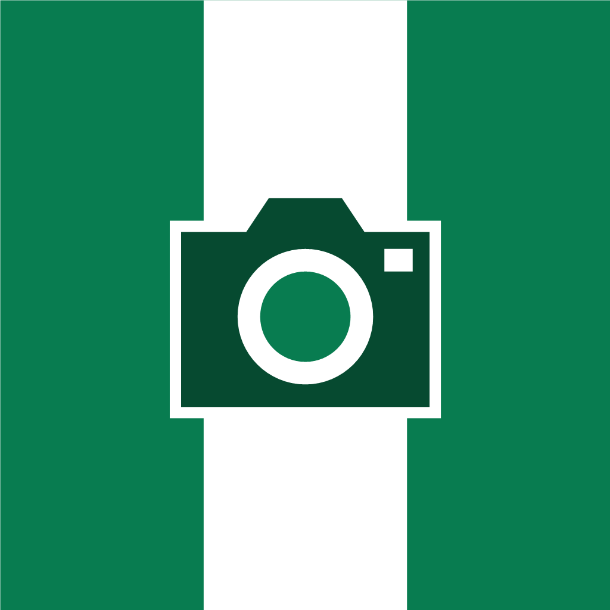
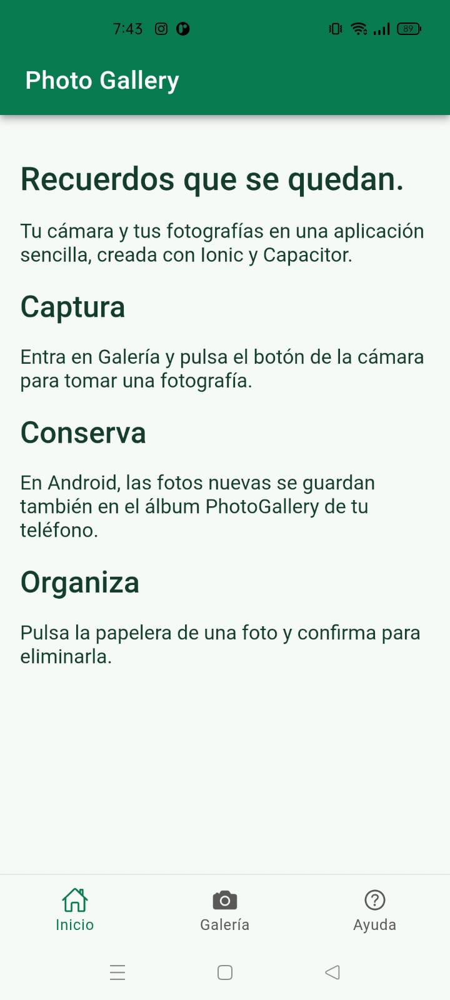
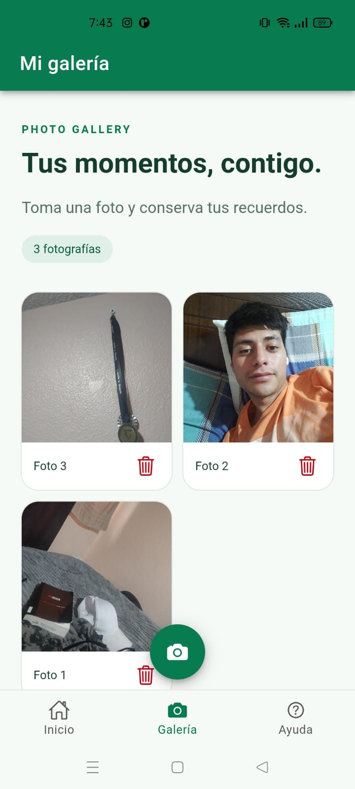
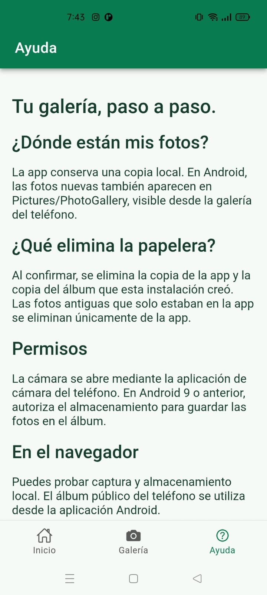
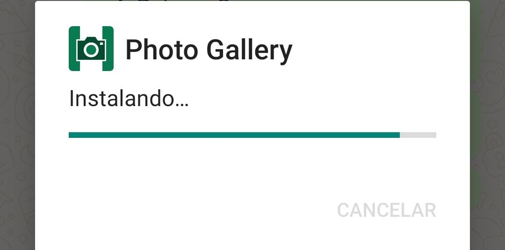
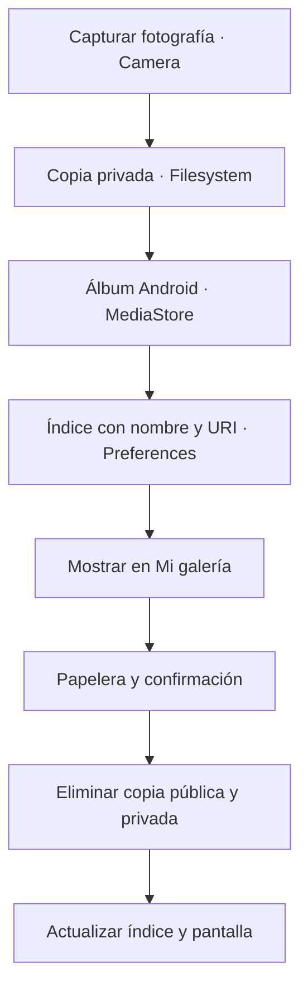

<div align="center">



# Photo Gallery

**APP GALLERY**

Aplicación móvil desarrollada con Ionic Angular y Capacitor para tomar fotografías, guardarlas en Android y eliminarlas con confirmación.


[Descargar APK](https://github.com/Dilanbkr7/photo-gallery/raw/refs/heads/main/apk/PhotoGallery-debug.apk) · [Capturas](#capturas-reales-en-el-teléfono) · [Instalación](#ejecutar-el-proyecto) · [Pruebas](#validación)

</div>

---

## Objetivo de la práctica

> Crear una aplicación que permita tomar fotos, guardarlas y eliminarlas en la galería del teléfono. Entregar un repositorio de GitHub con un README detallado y capturas de pantalla.

Photo Gallery implementa este flujo con una interfaz en español, tres pestañas y una identidad visual verde–blanco–verde. El proyecto incluye el código fuente, el proyecto Android, el APK de depuración y evidencias obtenidas en un teléfono real.

## Capturas reales en el teléfono

**Dispositivo:** realme RMX2063 · **Sistema:** Android 11 / API 30 · **Fecha:** 21 de octubre de 2026.

<table>
  <thead>
    <tr>
      <th>Inicio</th>
      <th>Galería</th>
      <th>Ayuda</th>
    </tr>
  </thead>
  <tbody>
    <tr>
      <td></td>
      <td></td>
      <td></td>
    </tr>
    <tr>
      <td>Explica cómo capturar, conservar y organizar fotografías.</td>
      <td>Muestra tres fotografías, el contador y las acciones de cámara y eliminación.</td>
      <td>Describe dónde se guardan las fotos y cómo funciona la aplicación.</td>
    </tr>
  </tbody>
</table>

### Instalación del APK



La captura registra el proceso de instalación y el icono personalizado. Las pantallas anteriores muestran la aplicación ya ejecutándose en el teléfono.

Las cuatro imágenes son capturas aportadas durante la práctica. La galería con tres fotos acredita su visualización en la app; el guardado y borrado en el álbum público se comprobaron además con pruebas nativas. La secuencia visual de confirmación de borrado, el álbum externo y la reapertura de la app puede ampliarse siguiendo [el registro de evidencias](docs/CAPTURAS.md).

## Funcionalidades

| Función | Comportamiento |
| --- | --- |
| Tomar fotografías | Abre la cámara del dispositivo mediante Capacitor Camera. |
| Conservar las fotos | Guarda una copia privada y registra el índice para recuperarlo al volver a abrir la app. |
| Guardar en el teléfono | Publica las fotos nuevas en el álbum `Pictures/PhotoGallery` de Android mediante MediaStore. |
| Eliminar | Solicita confirmación y elimina la copia privada y la copia pública registrada por esta instalación. |
| Consultar la galería | Presenta las imágenes en una cuadrícula, con contador y botón de eliminar por foto. |
| Navegar | Incluye Inicio, Galería y Ayuda; la pantalla inicial es Galería. |
| Gestionar errores | Muestra mensajes de carga, guardado y eliminación, y bloquea acciones repetidas durante las operaciones. |
| Identidad visual | Icono de cámara con franjas verde–blanco–verde, versiones por densidad e icono adaptable Android. |

## Cómo funciona



**Camera** realiza la captura. **Filesystem** conserva el archivo privado. **Preferences** almacena los nombres y las URI, sin guardar el contenido completo de las imágenes en el índice.

El complemento local **DeviceGallery** publica y elimina las fotos en el álbum de Android. Se registra en `MainActivity` **antes de crear el puente de Capacitor**, para que esté disponible desde JavaScript al iniciar.

El borrado se limita a las URI registradas por esta instalación. La app no ofrece acceso general para borrar fotografías de otros álbumes.

## Tecnologías

| Componente | Versión declarada |
| --- | --- |
| Ionic Angular | `^9.0.0` |
| Angular | `22.1.7` |
| Capacitor Core / CLI | `8.5.3` |
| Capacitor Android | `^8.5.3` |
| Capacitor Camera | `^8.2.5` |
| Capacitor Filesystem | `^8.1.4` |
| Capacitor Preferences | `^8.0.1` |
| TypeScript | `~6.0.0` |

Las versiones resueltas se encuentran en `package-lock.json`. Utiliza `npm ci` para reproducir la instalación.

## Ejecutar el proyecto

### Requisitos

- Git.
- Node.js y npm. Entorno comprobado: **Node 24.16.0 y npm 11.13.0**.
- Para Android: **JDK 21**, Android Studio y **SDK Platform 36**.
- Un teléfono compatible o un emulador para las pruebas.

### Descargar e iniciar en el navegador

Desde CMD:

```bat
git clone https://github.com/Dilanbkr7/photo-gallery.git
cd photo-gallery
npm ci
npm start
```

Abre la dirección indicada por el servidor; normalmente es `http://localhost:4200`.

En el navegador se utiliza su almacenamiento local y sus permisos de cámara. La integración con el álbum público del teléfono se ejecuta desde la aplicación Android.

### Compilar y abrir Android Studio

Detén el servidor con `Ctrl + C` y ejecuta desde la raíz:

```bat
npm run build
npx cap sync android
npx cap open android
```

La carpeta `android/` forma parte del repositorio. No es necesario volver a añadir la plataforma.

Espera la sincronización de Gradle, selecciona tu teléfono o emulador y pulsa **Run**. Para compartir un APK, genera la variante **debug** desde el menú Build de Android Studio o utiliza CMD:

```bat
cd android
gradlew.bat :app:assembleDebug
cd ..
```

**Archivo generado:** `android/app/build/outputs/apk/debug/app-debug.apk`.

Después de modificar la parte web, repite `npm run build` y `npx cap sync android` antes de compilar Android.

## Descargar e instalar el APK

[**Descargar PhotoGallery-debug.apk**](https://github.com/Dilanbkr7/photo-gallery/raw/refs/heads/main/apk/PhotoGallery-debug.apk)

1. Descarga el archivo en el teléfono.
2. Ábrelo y autoriza la instalación desde la aplicación utilizada si Android lo solicita.
3. Instala **Photo Gallery** y abre la pestaña Galería.
4. Pulsa la cámara y confirma una foto.
5. Comprueba su aparición en la app y en el álbum **PhotoGallery** del teléfono.

| Propiedad del APK | Valor |
| --- | --- |
| Nombre visible | Photo Gallery |
| Identificador | `com.dilanbkr7.photogallery` |
| Versión Android | `1.0` · código `1` |
| SDK mínimo declarado | API 24 |
| SDK objetivo | API 36 |
| Tipo | Depuración, firmado con clave de desarrollo |

El APK incluye los archivos web y funciona sin mantener encendido el servidor de desarrollo. El mínimo declarado no garantiza compatibilidad con todos los WebView antiguos; las pruebas físicas de esta entrega se realizaron en Android 11.

<details>
<summary>Comprobar la integridad del APK</summary>

SHA-256 de `apk/PhotoGallery-debug.apk`:

```text
DB4BF0FC99ABA4DB07495F2DEB9A420D0E1EA17D03EC581B7A2CB0D1983FFCC6
```

</details>

## Validación

| Verificación | Resultado |
| --- | --- |
| Instalación reproducible de dependencias | Correcta |
| Compilación web de producción | Correcta |
| Revisión estática | Sin errores |
| Pruebas web de componentes y servicio | **13 aprobadas** |
| Compilación y firma del APK | Correctas |
| Instalación en realme RMX2063 | Correcta |
| Pruebas instrumentadas en Android 11 | **3 aprobadas** |
| Pantallas Inicio, Galería y Ayuda | Documentadas con capturas reales |
| Fotos visibles en la aplicación | Tres fotografías en la captura aportada |

Las pruebas nativas verifican el identificador de la app, el registro de DeviceGallery y un ciclo real de escritura, lectura y eliminación de una imagen de diagnóstico en MediaStore. También comprueban que se rechace el borrado de una URI no registrada. La imagen de diagnóstico se eliminó al finalizar.

Para ejecutar las comprobaciones web:

```bat
npm run build
npm run lint
npm test -- --watch=false
```

Con un dispositivo Android compatible conectado, las pruebas instrumentadas pueden ejecutarse desde Android Studio o con:

```bat
cd android
gradlew.bat :app:connectedDebugAndroidTest
cd ..
```

El caso de MediaStore automatizado requiere API 29 o posterior. El flujo de permisos de Android anteriores se debe comprobar por separado. Consulta [el registro de validación](docs/VALIDACION.md).

## Estructura del proyecto

```text
photo-gallery/
├── android/
│   └── app/src/
│       ├── main/java/com/dilanbkr7/photogallery/
│       │   ├── MainActivity.java
│       │   └── DeviceGalleryPlugin.java
│       └── androidTest/                Pruebas en dispositivo
├── apk/
│   └── PhotoGallery-debug.apk          APK de la entrega
├── docs/
│   ├── screenshots/                    Cuatro capturas reales
│   ├── CAPTURAS.md                     Evidencias y comprobaciones adicionales
│   └── VALIDACION.md                   Resultados y alcance de las pruebas
├── src/
│   ├── app/
│   │   ├── services/                   Captura, persistencia y puente nativo
│   │   ├── tab1/                       Inicio
│   │   ├── tab2/                       Galería
│   │   └── tab3/                       Ayuda
│   └── assets/icon/                    Icono PNG y fuente SVG
├── capacitor.config.ts
├── package.json
└── README.md
```

## Permisos y almacenamiento

- En Android 10 o posterior, la app publica sus imágenes mediante MediaStore sin solicitar acceso general a la biblioteca.
- En Android 9 y anteriores, se solicita escritura en almacenamiento; el permiso se declara con `maxSdkVersion=28`.
- Las fotos privadas de versiones anteriores no se exportan automáticamente al álbum público.
- Al desinstalar la app se eliminan sus datos privados. Las fotos públicas que permanezcan deben gestionarse desde la galería del teléfono.
- El álbum público está implementado para Android. Esta entrega no incluye su equivalente para iOS.
- El APK es de depuración; publicar en una tienda requiere preparar la firma y configuración de lanzamiento.

## Solución de problemas

| Situación | Solución |
| --- | --- |
| El SDK Android no se encuentra | Configura su ruta desde Android Studio o define `ANDROID_HOME` con la ubicación de tu SDK. |
| El teléfono no aparece por USB | Comprueba cable, autorización y controlador; Android 11 permite vincularlo mediante depuración inalámbrica. |
| Se intenta instalar un APK exclusivo para pruebas | Comparte el archivo de `build/outputs/apk/debug/`, no el de `build/intermediates/`. |
| Una actualización informa firmas incompatibles | Las actualizaciones deben usar la misma clave. Esta app tiene un identificador propio y puede coexistir con el antiguo `io.ionic.starter`. |
| DeviceGallery no está disponible tras modificar Android | Mantén su registro antes de `super.onCreate`, recompila e instala el APK actualizado. |
| Aparece una advertencia de navegadores no soportados | La configuración original incluye versiones antiguas fuera del soporte de Angular; usa un navegador o WebView compatible. |

## Autor y referencias

**Autor:** [Dilanbkr7](https://github.com/Dilanbkr7)<br />
**Asignación:** Cámara de fotos con Ionic.

- [Ionic: Photo Gallery con Angular](https://ionicframework.com/docs/angular/your-first-app).
- [Capacitor: Camera](https://capacitorjs.com/docs/apis/camera).
- [Capacitor: Filesystem](https://capacitorjs.com/docs/apis/filesystem).
- [Android: MediaStore y archivos compartidos](https://developer.android.com/training/data-storage/shared/media).
- [Android Studio: ejecutar en un dispositivo](https://developer.android.com/studio/run/device).
